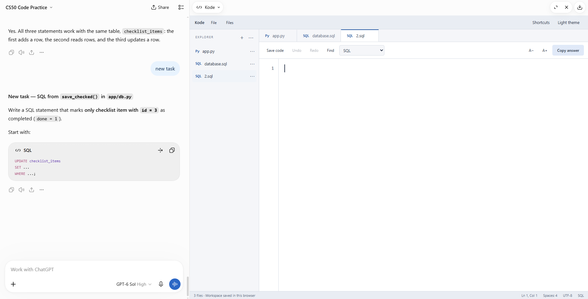

# Kode

A self-contained light code editor for working beside a ChatGPT conversation.

*Kode in ChatGPT’s side preview, with the conversation alongside it.*

## Open Kode beside a ChatGPT conversation

In a ChatGPT interface that supports interactive HTML previews, share this repository and ask:

> Open the full `Kode.html` from https://github.com/sbf-developer/kode-editor-within-gpt-chat as an **interactive HTML preview in the panel beside this chat**. I want to type in the editor, create files, and use Copy answer. Show the working app, not a screenshot or a view of its source code.

If ChatGPT produces an HTML file in **Outputs**, open that file's preview. Keep the chat visible alongside it. Use **Copy answer** in Kode, then paste the code into the conversation when you want feedback. Kode cannot read the chat or send unsent edits on its own.

The side preview is a ChatGPT interface feature, so whether it opens automatically depends on the conversation and available tools. A Library or GitHub link by itself may show a file or start a download rather than launch the editor in the side panel.

### Open Kode in a browser

1. Download [Kode.html](Kode.html) using GitHub's raw-file download.
2. Open the downloaded file in Chrome or another modern browser.
3. Put its window beside your ChatGPT conversation.
4. Write your code, select **Copy answer**, and paste it into the chat.

Everything is bundled in the HTML file. No installation, build, account, or internet connection is required after downloading.

**Copy answer copies the active file's source as plain text**, without line numbers or screenshots. If automatic clipboard access is blocked, Kode provides a text-selection fallback.

## Files and tabs

- Left-click **+** in the explorer, or choose **File → New file**, to start a new file.
- Type the name inline, then press **Enter** or click **✓**. Press **Esc** or **×** to cancel.
- Left-click **⋯** beside a file for its actions. Right-clicking a file or tab opens the same menu.
- Choose **Rename…** to edit the name inline. **F2** renames the active file. Recognized extensions select its syntax mode.
- Choose **Delete** to remove the selected file after confirmation.
- **File → Restore deleted** recovers the latest deleted file, including its code. Only the most recent deletion is retained.
- **File → Open files…** imports one or more source files into separate tabs. Existing files are preserved; duplicate imported names receive a number.
- **Save code**, or **File → Save file**, downloads source text with its current name.
- Click **Files** in the title bar to show or hide the explorer.

The explorer lists files directly. Kode is the app name, not a folder or filesystem root.

Each file keeps its own code, language, cursor position, and undo history while Kode stays open. File contents, names, modes, the active tab, and the latest deleted file are saved in browser storage when available. Undo history is retained during the session, not across reloads.

Deleting the final file opens a blank file so the workspace remains usable.

Names must be unique within the workspace and cannot contain slashes. Changing a language mode updates the file extension without overwriting another file.

File creation and renaming use direct button and keyboard handlers, with no HTML form submission. They work in restricted previews that allow scripts but block forms. Such previews may also block browser storage; Kode displays that limitation and keeps editing available for the current session.

## Reuse in another ChatGPT conversation

Share this repository and say:

> Open Kode.html from https://github.com/sbf-developer/kode-editor-within-gpt-chat as a working, interactive HTML preview in the panel beside this chat. Keep the editor usable; do not show only code or an image.

For practice, you can add:

> Give me one small coding problem at a time. Let me answer with code, pseudocode, or a mix, then review my attempt. Keep the solution hidden until I ask.

Interactive previews depend on the ChatGPT interface. Kode does not install a native ChatGPT sidebar or enable Canvas. The browser workflow above works independently of a ChatGPT side preview.

Kode cannot see the conversation, and ChatGPT cannot see unsent edits. Copy your answer into the chat to share it.

## Editor features

- CodeMirror syntax highlighting and line numbers.
- C, Python, SQL, JavaScript, HTML/Jinja, CSS, and plain text/pseudocode modes. HTML/Jinja highlights template tags alongside HTML, CSS, and inline JavaScript.
- Tab/Shift+Tab indentation, automatic indentation, bracket pairing and matching, and automatic closing tags in HTML.
- Independent file tabs, undo/redo, find/replace, and comment shortcuts.
- Dark/light themes and adjustable text size.
- Offline use and browser-local workspace saving. Existing `.html` and `.css` drafts saved as plain text gain highlighting when opened with the new version.

Kode edits text; it does not compile or run programs.

## Shortcuts

| Action | Shortcut |
| --- | --- |
| Indent / outdent | Tab / Shift+Tab |
| Undo / redo | Ctrl+Z / Ctrl+Shift+Z |
| Find / replace | Ctrl+F / Ctrl+H |
| Toggle comment | Ctrl+/ |
| Save active source file | Ctrl+S |
| Select all code | Ctrl+A |
| Rename active file | F2 |
| Leave editor input | Esc |
| Switch focused file tabs | Left / right arrow |

Command-key equivalents are provided on Mac. Browser or OS shortcuts may take precedence.

## Keeping your work

Workspace drafts stay in your browser and are not uploaded. Use **Save code** for each file to keep independent copies, especially before moving or renaming the downloaded HTML, changing browsers, or clearing browser data.

When old and new versions can access the same browser storage, Kode imports the previous single-file editor's saved draft on first use. If you downloaded the new version to another location and your draft does not appear, save your code in the old editor and use **Open** in Kode.

## Repository files

- `Kode.html`: complete offline editor with all styles, scripts, and dependencies.
- `AGENTS.md`: guidance for assistants reusing or maintaining Kode.

CodeMirror 5.65.16 is bundled under the MIT license. Its copyright and full license notice are embedded in the HTML source.
